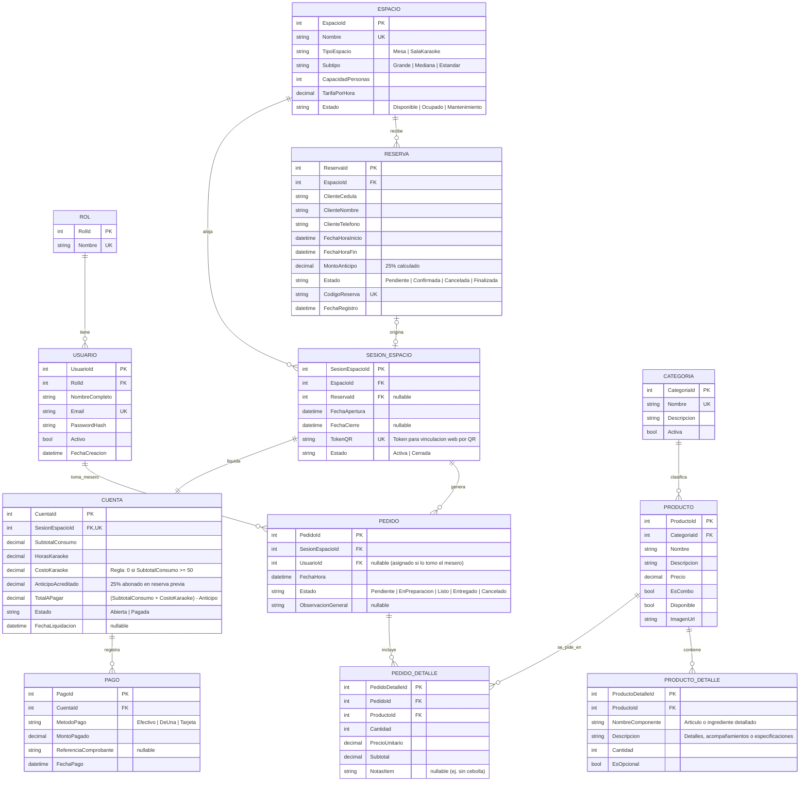

# Modelo Relacional de Base de Datos - ArcanosBar

**Proyecto:** ArcanosBar - Sistema de Gestión de Bar Karaoke  
**Motor de Base de Datos:** Microsoft SQL Server  
**ORM:** Entity Framework Core  
**Asignatura:** Diseño de Aplicaciones y Servicios para Internet (ITID803)  

---

## 1. Diagrama Entidad - Relación (Mermaid)

---

## 2. Diccionario de Datos y Módulos

### 2.1 Módulo de Seguridad y Usuarios
* **`ROL`**: Almacena los perfiles de acceso autorizados (*Administrador, Cajero, Mesero, Cocinero*).
* **`USUARIO`**: Credenciales y datos del personal del bar con contraseñas encriptadas mediante hash y validación de estado activo.

### 2.2 Módulo de Espacios y Reservas
* **`ESPACIO`**: Modela las 6 salas de karaoke (2 grandes, 4 medianas) y las 10 mesas de comedor para 4 comensales. Incluye su tarifa horaria y estado físico.
* **`RESERVA`**: Contiene la solicitud de agendamiento del cliente (Cédula, Nombre, Teléfono), el rango de horas, el cálculo del **anticipo del 25%** y su código único de seguimiento.

### 2.3 Módulo de Menú y Catálogo
* **`CATEGORIA`**: Agrupación del catálogo (*Bebidas con alcohol, Bebidas sin alcohol, Comidas, Combos*).
* **`PRODUCTO`**: Artículos y combos comercializados con su precio base, indicador booleano `EsCombo` y disponibilidad en barra/cocina.
* **`PRODUCTO_DETALLE`**: Desglosa los componentes o ingredientes tanto de combos como de platos de comida (ej. qué incluye una hamburguesa o los productos que conforman un combo).

### 2.4 Módulo Operativo de Pedidos
* **`SESION_ESPACIO`**: Representa la estancia activa de un grupo en una mesa o sala. Genera un `TokenQR` para que los comensales accedan al menú sin registro de credenciales.
* **`PEDIDO`**: Cabecera de la comanda/orden enviada por la app web o tomada por el mesero. Maneja los estados: *Pendiente, En Preparación, Listo para Servir, Entregado, Cancelado*.
* **`PEDIDO_DETALLE`**: Desglose de productos, cantidades pedidas, precios históricos y notas específicas del comensal.

### 2.5 Módulo de Cuentas y Cobro
* **`CUENTA`**: Liquidación consolidada de la sesión. Implementa la regla de negocio de exoneración de horas de karaoke si el consumo de alimentos y bebidas alcanza o supera los **$50.00**, y resta el **25% de anticipo** abonado previamente.
* **`PAGO`**: Registro de las transacciones de liquidación soportando Efectivo, Transferencias digitales (DeUna, Banco) y Tarjetas de crédito/débito.
